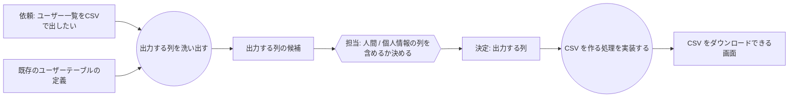

# cog-plan

実装の計画を、成果物とプロセスの流れ図にする。流れ図の形式は PFD（Process Flow Diagram。成果物とプロセスを交互につないだ図）を使う。

計画を流れ図にする目的は、読み手が計画を理解したうえで判断できるようにすること。エージェントが立てた計画の中には、判断の根拠と暗黙の仮定が埋もれている。`cog-plan` は、埋もれた判断と仮定を流れ図の上に出す。

## 使い方

```
/cog-plan 実装したい内容
```

実装したい内容が書かれていないときは、直前の会話から読み取る。読み取れないときは、質問を1つだけする。

## 出力には cognizable を適用する

始める前に、このスキルと同じ置き場にある `cognizable/SKILL.md` を読む。このスキルが出す文は、すべて `cognizable/SKILL.md` のルール R1〜R19 に従って書く。

`cognizable/SKILL.md` を読めないときは、読めないことを1行で読み手に伝える。そのうえで、次の5つを守って続ける。

1. 結論と次の行動を先頭に置く。
2. 読み手が覚えるか比べる項目は、4つまでにする。
3. 指示語を使わず、対象の名前をもう一度書く。
4. 主語と目的語を省略しない。
5. 前提から結論までの推論の段を飛ばさない。

このスキルが終わった後の応答は、`/cognizable` が有効なときだけ cognizable のルールに従う。

## PFD の決まり

PFD の要素は3つ。

| 要素 | 意味 | 流れ図での形 |
|------|------|--------------|
| 成果物 | プロセスが作るもの、または最初からあるもの。ファイル、データ、決定の結果など | 四角 |
| プロセス | 成果物を入力にして、別の成果物を作る作業 | 丸 |
| フロー | 成果物とプロセスをつなぐ矢印 | 矢印 |

守る決まりは4つ。

1. プロセスの入力は、必ず成果物として描く。入力のないプロセスを描かない。
2. プロセスの出力も、必ず成果物として描く。プロセスとプロセスを直接つながない。
3. 判断もプロセスとして描く。判断の出力は「決定の結果」という成果物にする。
4. 人が決める判断には、担当「人間」と書く。人が決める判断を、`cog-plan` は決めない。

## 人が決める判断の見分け方

次のどれかに当てはまる判断は、人が決める判断として扱う。

- 個人情報、権限、お金、法律や契約に関わる判断。
- 利用者に見える振る舞いを変える判断。
- 取り消せない操作を含む判断。
- コードや資料を調べても、答えが1つに決まらない判断。

コードや資料を調べれば答えが決まる事実は、判断ではない。`cog-plan` が自分で調べて、成果物に書く。

## 手順

1. 最後に必要な成果物を1つ決める。例: 「ユーザー一覧を CSV でダウンロードできる画面」。
2. 最後の成果物を作るプロセスを書く。次に、そのプロセスの入力になる成果物を書く。
3. 手順2を、最初からある成果物（既存のコード、既存のデータ、依頼の文）にたどり着くまで繰り返す。
4. 逆算の途中で出てきた判断を、プロセスとして書き足す。人が決める判断に、担当「人間」と書く。
5. 逆算の途中で置いた仮定を書き出す。仮定は「確かめていないが、正しいとして計画に使ったこと」。
6. 流れ図を、最初の成果物から最後の成果物へ向かう一方向に並べ直す。
7. 下の「出力の形」に従って出す。

## 出力の形

出力は、次の順番に固定する。

1. 結論: 計画全体を1〜2文で書く。プロセスの数と、人が決める判断の数を書く。
2. 流れ図: 下の「流れ図の書き方」に従う。
3. 人が決める判断: 表にする。列は「判断」「決めるための材料」「決めないと止まるプロセス」の3つ。
4. 仮定: 箇条書きにする。仮定ごとに、確かめる方法を1つ書く。
5. 次の一手: 1つだけ書く。人が決める判断が残っていれば、「`/cog-ask` で判断を1問ずつ決める」を次の一手にする。

人が決める判断と仮定が5つ以上あるときは、判断が必要になる順に並べ、4つずつに分ける。

## 流れ図の書き方

- 流れ図は Mermaid の `flowchart` で書く。向きは、左から右（`LR`）か、上から下（`TD`）のどちらか1つにする。1枚の図の中で向きを混ぜない。
- 成果物は四角 `[ ]`、プロセスは丸 `(( ))`、人が決める判断は六角形 `{{ }}` で書く。
- 人が決める判断のラベルには、「担当: 人間」と書く。形だけで区別させない。
- ラベルは図の中に直接書く。記号だけのノードを作らない。
- 1枚の図は9ノードまでにする。9ノードを超えるときは、図を分ける。
- 図を分けるときは、最初に概要の図を1枚出す。概要の図は3〜4ブロックにする。次に、ブロックごとの図を出す。
- 図のすぐ下に、図が示す主張を1文で書く。
- Mermaid を表示できない環境では、番号を付けた行と矢印（`→`）で同じ内容を書く。
- 読み手が HTML を頼んだときは、`cognizable/assets/template.html` を元に、4層の HTML にする。

流れ図の例:



この図の主張: 出力する列を人が決めるまで、CSV を作る処理の実装は始められない。

## してはいけないこと

- 人が決める判断を、`cog-plan` が推奨だけで確定させない。推奨は「決めるための材料」に書く。
- 計画を出した後、読み手の確認なしに実装を始めない。
- 逆算で出てこなかった作業を、計画に足さない。

## 4つのスキルの流れ

| 順番 | スキル | 役割 |
|------|--------|------|
| 1 | `cog-plan` | 実装の計画を、成果物とプロセスの流れ図にする |
| 2 | `cog-ask` | 設計の問いを、1回に1問ずつ読み手に出す |
| 3 | `cog-learn` | 読み手が詰まった箇所を、約5分のレッスンで教える |
| 4 | `cog-review` | 変更の差分を、読む順番と説明を付けて案内する |

4つのスキルは、単独でも使える。
